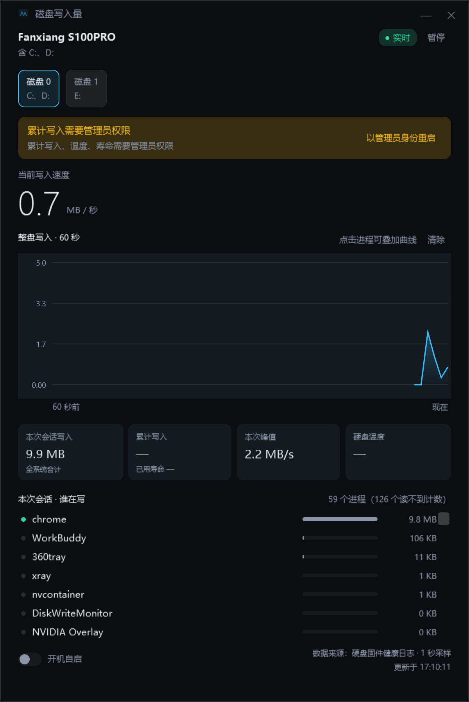

# 磁盘写入量 · Windows 版

一个常驻托盘的桌面小窗口：显示硬盘当前写入速度、本次会话累计写入，
并列出各进程累计写了多少；正在写的进程有绿点，可点选进程叠加曲线。

**对应 macOS 版本：v2.4**。本仓库是独立实现，不复用 macOS 版的 Swift 代码，
只共享 `WINDOWS-PORT.md` 定义的行为契约。

## 与 macOS 版的关系

| 项 | 说明 |
| --- | --- |
| 行为契约 | `WINDOWS-PORT.md`（从 macOS 仓库同步过来的快照） |
| 变更记录 | `CHANGELOG.md`（同上，用来判断本次同步范围） |
| 代码 | 完全独立，C# + WPF |
| 图标资源 | 暂用系统图标，待补 |

## 数据是怎么来的

| 指标 | Windows 实现 | 口径 | 需要管理员 |
| --- | --- | --- | --- |
| 速率 / 本次会话 / 峰值 | 读取 `PhysicalDisk` 的**原始累计字节**（`PdhGetRawCounterArray`），做差得到速率与会话量 | **该盘真实写入字节**（按磁盘分开统计） | 否 |
| 自开机累计 | 同上（原始累计值的绝对值） | 自开机以来该盘写入总量 | 否 |
| 累计写入（出厂至今） | NVMe 健康日志 / SATA SMART 属性 241 | 硬盘固件记录的落盘量 | 是 |
| 温度 / 寿命 | 同上 | 固件传感器 | 是 |
| 各进程写入量 | `GetProcessIoCounters` 的 `WriteTransferCount` | 系统收到的**写请求量，含管道与套接字** | 否（但提权能看到更多进程） |

三个关键点：

1. **速率与会话量是字节级精确的**：不用「速率 × 时间」积分，而是读系统维护的自开机累计字节再做差，
   所以短促爆发也不会漏算或多算。
2. **按磁盘分开统计**：每块盘的会话写入量互相独立，切换磁盘只是换显示对象。
3. **进程排行口径不同，会显著虚高**：`WriteTransferCount` 把管道/IPC 写入也计入。
   实测 `nvcontainer` 某次 2 分钟"写入"790 MB，同期整块盘所有进程实际落盘仅 94 MB —— 约 12%。
   所以进程排行适合**找嫌疑人**，不适合**估算磨损**。判断磨损请看盘级累计写入。

## 下载与安装

1. 到 [Releases](../../releases) 下载 `DiskWriteMonitor.exe`
2. 双击运行即可，**不需要安装 .NET 运行时**（自包含单文件）
3. 想读「累计写入 / 温度 / 寿命」需要管理员权限：
   界面出现提示条时点「以管理员身份重启」，或者右键 exe →「以管理员身份运行」

想开机自启，打开界面左下角「开机自启」开关即可（走 HKCU Run，不需要提权）。



## 每日写入量流水

程序会把每天的写入量记到 `%LOCALAPPDATA%\DiskWriteMonitor\daily-writes.csv`，每天每块盘一行：

```
date,disk,model,letters,bytes,gb,monitoredHours
2026-10-25,0,Fanxiang S100PRO,C:、D:,18938880,0.02,0.034
2026-10-25,1,NVMe Asgard AN2 1TNVMe-M.2/80,E:,319488,0.00,0.034
```

用途：SATA 固态的固件累计写入值不一定可信（廉价盘常把 SMART 241 记成别的单位），
拿不到「出厂至今总量」时，就靠这个文件挂几周，用 `gb` 的日均值估算这块盘还能撑多久。

**注意 `monitoredHours` 字段**：只统计本工具**运行期间**的写入量，关机/退出期间不计。
别把「跑了 3 小时的 20GB」当成「一整天 20GB」，用 `gb ÷ monitoredHours` 才是真实速度。

写盘节奏：每 5 分钟一次 + 退出时一次；同日覆盖同一行，跨天自动结转，临时文件原子替换。

## 系统要求

- Windows 10 1809 及以上 / Windows 11，64 位
- 读取硬盘固件写入量**需要管理员权限**；不提权也能用，只是盘级数据读不到，
  界面会显示「需要管理员权限」并提供一键重启按钮
- 仅 NVMe 硬盘支持写入寿命统计。SATA / 机械硬盘会显示「不支持」

## 权限说明（重要）

按 `WINDOWS-PORT.md` §7 的建议，第一版**没有**把整个进程设成强制提权
（`requireAdministrator`），原因是那样会让「开机自启」在登录时被 UAC 拦掉，自启等于失效。
现在的做法是：

- 清单里是 `asInvoker`，正常双击启动，不弹 UAC
- 读不到硬盘数据时，界面上出现提示条 + 「以管理员身份重启」按钮
- 开机自启走 `HKCU\Software\Microsoft\Windows\CurrentVersion\Run`，不需要提权

## 已知限制

- 只活几百毫秒的进程可能来不及被采样（1 秒采样），不会出现在排行里
- 部分系统进程拿不到计数，列表里会标注「N 个读不到计数」
- 累计值在应用重启后归零，与 macOS 版一致
- 默认监控第一块物理磁盘；多盘选择待做（契约也未要求）
- 被 Intel RST / VMD 接管的 NVMe 可能读不到健康日志，会归类为「读取失败」
- 应用只读监控；除每天一次版本检查外不联网，不上传任何数据

## 验证记录（2026-10-25，Windows 10 19045）

| 项目 | 结果 |
| --- | --- |
| 真实写入 500 MB 后「本次会话写入」 | 527 MB（多出部分为同期后台写入） |
| 同一时段的「本次峰值」 | 488 MB/s（实测平均 419 MB/s） |
| 进程归因 | `pwsh` 524 MB 排第一，正是执行写入的进程 |
| 盘级温度（SATA 属性 194） | 40 ℃，与固件一致 |
| 进程覆盖度 | 非提权 138/266 可读；提权后 263/264 可读 |
| 进程扫描耗时 | 264 个进程 3 ms |
| 单实例 / 关窗收托盘 | 通过（第二次启动只激活已有窗口） |

## 自己构建

需要 .NET 8 SDK：

```powershell
dotnet build src\DiskWriteMonitor\DiskWriteMonitor.csproj -c Release
dotnet publish src\DiskWriteMonitor\DiskWriteMonitor.csproj -c Release
```

发布产物是自包含单文件 exe（`bin\Release\net8.0-windows\win-x64\publish\`），
目标机器不需要装运行时。

## 探针

`tools\probe` 是一个独立的小工具，用来验证本机到底能不能拿到这几项数据。
它不属于产品，验证完可以删掉。

```powershell
cd tools\probe
dotnet publish -c Release
```

然后双击 `run-probe-as-admin.cmd`（会请求管理员权限），结果写在
`tools\probe\dist\report-admin.txt`。

## 许可证

GPL-2.0，与 macOS 版保持一致。
